# aircraft-doppler-geolocation

Hermes plugin that locates where (and optionally when) a recording was made from the Doppler curves of aircraft flying over, often too faint to hear, matched against ADS-B flight tracks. It ships one skill, two Hermes tools (`doppler_detect`, `doppler_locate`), a `dopplergeo` CLI, and three standalone scripts.

It is a community plugin by [Kyle Durepos](https://github.com/mojomast). It is not a Nous Research product. The method comes from colsto's video [I discovered a sound that leaks your exact location (and it's everywhere)](https://www.youtube.com/watch?v=UytYrhYLOKI). The author released no code; these scripts are an independent implementation of the steps he describes, not his pipeline.

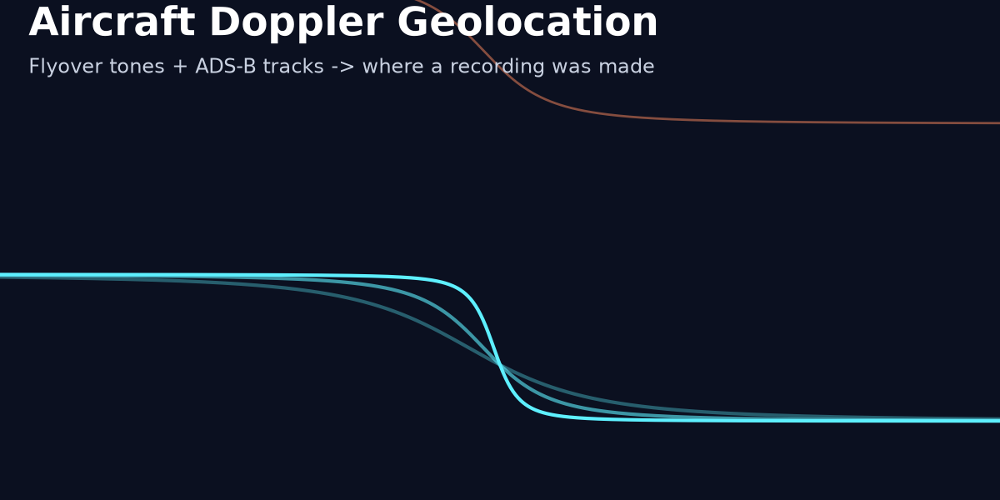

**Status:** 0.3.1, released 2026-11-03 (tag `v0.3.1`). It locates clean multi-pass recordings to within about 1 km but mostly fails on unseen clips: 2 of 18 held-out runs came in under 3 km. Read [Real-world results](#real-world-results) before you trust any output.

Contents: [Install](#install) · [Quick start](#quick-start) · [CLI](#cli) · [Hermes tools](#hermes-tools) · [How it works](#how-it-works) · [Data sources and licences](#data-sources-and-licences) · [Evaluation](#evaluation-harness) · [Real-world results](#real-world-results) · [Limitations](#limitations) · [Privacy and ethics](#privacy-and-ethics)

## Install

Until a maintainer lists it in the Hermes catalog:

```bash
hermes plugins install mojomast/hermes-aircraft-doppler-geolocation --no-enable
hermes plugins enable aircraft-doppler-geolocation
```

After catalog acceptance, the reviewed install is `hermes plugins install aircraft-doppler-geolocation`.

For the CLI and the library on their own (Python 3.11+, `ffmpeg` on PATH for video and compressed audio):

```bash
git clone https://github.com/mojomast/hermes-aircraft-doppler-geolocation && cd hermes-aircraft-doppler-geolocation
pip install -e .          # installs the `dopplergeo` console script
```

From a checkout without installing, use `python3 -m dopplergeo` in place of `dopplergeo`.

## Quick start

```bash
dopplergeo detect clip.wav --out ev/                                         # find flyovers (offline)
dopplergeo locate clip.wav --date 2026-09-21 --region 43.8,-79.3,8 --out run/ # download ADS-B for the day and search
dopplergeo locate clip.wav --date 2026-09-21T14:13:20Z --time-tolerance 30 --region 43.8,-79.3,8 --offline --out run/
dopplergeo locate clip.wav --date 2026-09-21T14:13:20Z --time-tolerance 30 --region 43.8,-79.3,8 --broadband --out run/  # + jet passes
```

`detect` writes `detect.json` and `detection.png`. `locate` writes `report.json` and `heatmap.png` and prints the report. The exit code is 2 when `ok` is false (for example: no events, or `--offline` with nothing cached for that day and region).

Offline self-test, no network, no input files:

```bash
python3 skills/aircraft-doppler-geolocation/scripts/make_synthetic_test.py   # prints SELF-TEST PASSED
```

## CLI

`python3 -m dopplergeo detect RECORDING [--out DIR] [--broadband] [--no-plots] [--no-cache]`

| Flag | Meaning |
| --- | --- |
| `RECORDING` | Any audio or video file ffmpeg can decode (resampled to 4 kHz mono). |
| `--out DIR` | Output directory. Default: `<recording>.doppler/`. |
| `--broadband` | Also detect jet passes from the ground-reflection (Lloyd's mirror) delay (experimental, default off). |
| `--no-plots` | Skip `detection.png` (default: written). |
| `--no-cache` | Re-run detection even if the event cache already has this audio and these detector settings. |

`python3 -m dopplergeo locate RECORDING [--date D] [--region R] [--offline] [--time-tolerance S] [--include-jets] [--broadband] [--temper-extra K] [--out DIR] [--no-plots] [--no-cache]`

| Flag | Meaning |
| --- | --- |
| `--date` | `YYYY-MM-DD`: the whole UTC day is searched for the start time (slow, ambiguous). An ISO datetime (`2026-09-21T14:13:20Z`, UTC unless an offset is given) is the recording start, searched ± `--time-tolerance`. If omitted, file metadata is used: ffprobe `creation_time`, or the upload date from a yt-dlp `.info.json`. |
| `--region` | `lat,lon,radius_km`, radius at most 60 km. Required unless the file carries GPS tags. If it does, those coordinates are reported directly (`method: metadata-gps`). |
| `--offline` | Use only the cache (ADS-B crops, DEM, weather). No network. |
| `--time-tolerance` | Seconds of slack around an ISO datetime. Default 600. The evaluation uses 30. |
| `--include-jets` | Also score known jet types against tonal events. Default off: jets rarely give tonal lines and add false matches. Broadband events always consider jets. |
| `--broadband` | Also detect and score broadband (ground-reflection) jet passes. Experimental, default off. In the held-out run it gave more answers but a slightly worse median (see results). |
| `--temper-extra` | Posterior temper on top of the Birge ratio, which sets how wide the 68 %/95 % areas are. Default 4, calibrated on tune. Larger values give wider, safer areas. |
| `--out` | Output directory. Default: `<recording>.doppler/`. |
| `--no-plots` | Skip `detection.png` and `heatmap.png` (default: both written). |
| `--no-cache` | Bypass the event cache (see below). |

`locate` checks that a region and a date (hint or file metadata) are available before it decodes any audio, so a missing hint fails in milliseconds; the report then has no `events`.

The same options from Python: `locate.locate(..., broadband=True, temper_extra=4, plots=True, cache=True)` and `locate.detect_only(rec, out, broadband=True, plots=True, cache=True)`. Other scorer settings are `dopplergeo.score.Options` fields, which the eval harness sets with `--set key=value`.

**Cache.** Downloads are cached in `~/.cache/doppler-geo`, or in `$DOPPLER_GEO_CACHE` if set: ADS-B crops per day and region, DEM tiles, weather and the type table. Writes are atomic, so parallel runs can share one cache. Only the crop of each adsb.lol day is stored, not the ~3 GB release.

**Event cache.** Detected events are cached in `<cache>/events/` keyed by the SHA-256 of the audio file bytes, the decode rate, the detector settings (`broadband`, ...) and a hash of the detector source (`detect.py`, `broadband.py`, `physics.py`). `detect` followed by `locate`, or `locate` again with another region, date, tolerance or scorer setting, reuses the detection instead of repeating it; a changed file or detector is a miss. Reports carry `detection_cache.hit`. Entries are JSON written atomically; a corrupt or mismatched entry is ignored and replaced; the directory keeps the 500 most recently used entries (90 days). Disable per call with `--no-cache` / `cache: false`. On a hit with plots on, only the dB spectrogram is recomputed to draw `detection.png`.

## Hermes tools

The plugin registers one skill, `aircraft-doppler-geolocation:aircraft-doppler-geolocation`, and two tools in the `aircraft-doppler-geolocation` toolset. Both return one JSON document; on errors they return `{"ok": false, "error": "..."}` and do not raise.

| Tool | Parameters | Network |
| --- | --- | --- |
| `doppler_detect` | `recording` (required), `out_dir`, `broadband` (bool, default false) | none |
| `doppler_locate` | `recording` (required), `date_hint` (`YYYY-MM-DD` or ISO datetime), `region_hint` (`lat,lon,radius_km`, ≤ 60 km), `offline` (bool), `time_tolerance_s` (default 600), `include_jets` (bool), `broadband` (bool, default false), `temper_extra` (number, default 4), `plots` (bool, default true), `cache` (bool, default true), `out_dir` | adsb.lol / GitHub, Copernicus DEM, Open-Meteo, unless `offline` |

Both tools also return `media` (one `MEDIA:<absolute path>` line per PNG the run wrote), `generated_image` (the same paths) and `media_hint`. Hermes renders `MEDIA:` lines in the agent's reply as inline images or attachments, so the agent can show `detection.png` and `heatmap.png` to the user.

`doppler_detect` returns `events` (per event: `kind` (`tonal`, or `broadband` when `broadband` is true), `t_cpa`, `f0_hz`, `speed_mps`, `cpa_slant_m`, `harmonics`, `snr_z`, `f_test`, `p_value`, plus `tau_max_s` and `T_s` for broadband events), `rejected_segments` with reasons, and `files.detection_png`.

`doppler_locate` example output. This is a real run on the synthetic two-pass scenario from `tests/test_v02.py` (two Cessnas, injected tracks), trimmed:

```json
{
  "ok": true,
  "method": "doppler-adsb",
  "best": {
    "lat": 43.80630, "lon": -79.30498, "logl": -6.84,
    "t0_unix": 1789999999.7,
    "recording_start_utc": "2026-09-21T14:13:19.700000+00:00",
    "n_consistent_events": 2,
    "confidence": "ok",
    "matches": [{"event": 0, "aircraft": "C172 BBB002", "class": "piston",
                 "cpa_slant_m": 1166.3, "event_cpa_slant_m": 1154.8,
                 "f0_scale": 1.0018, "chi2nu": 0.13, "cpa_ok": true}]
  },
  "top": [{"lat": 43.80630, "lon": -79.30498, "logl": -6.84}, "..."],
  "credible_area_km2": {"68": 0.36, "95": 0.72, "grid_step_m": 200.0},
  "files": {"heatmap_png": "run/heatmap.png", "report_json": "run/report.json"}
}
```

**How to read it.** Check `best.confidence` first. `ok` means at least 2 events matched an aircraft consistently, both in Doppler shape and CPA distance (`n_consistent_events`). With `low`, the report adds a `warning` and `credible_area_km2["95_low_conf"]`, which is the whole search disc: the answer is "somewhere in the region", not the point. Even with `ok`, the 95 % area is only roughly calibrated (`temper_extra=4`, set on 12 tune runs), and one held-out `ok` result was 13 km off. Treat every result as a hypothesis to confirm visually.

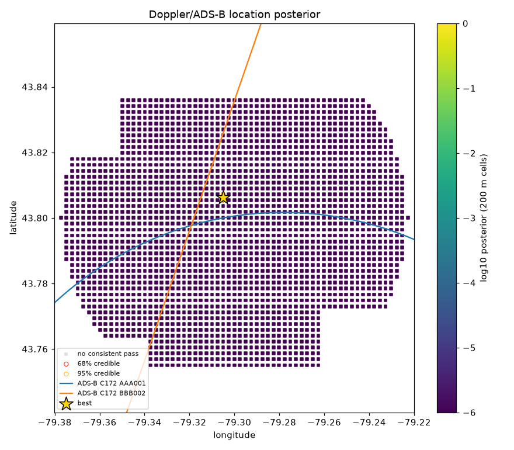
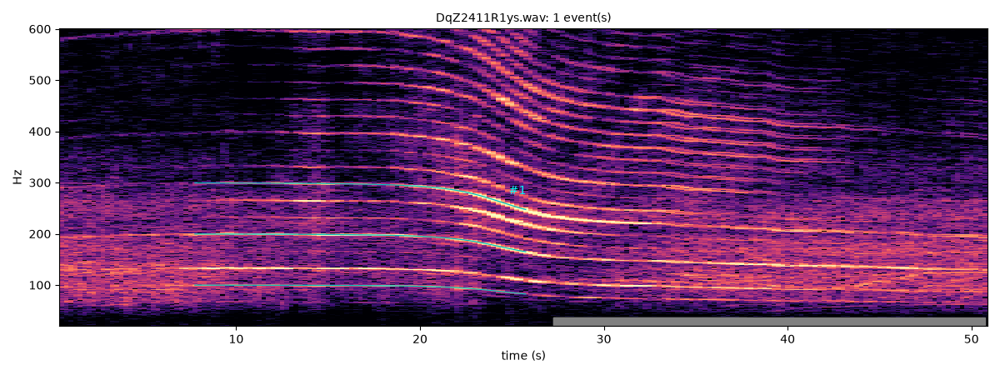

## How it works

**Tonal Doppler (0.2.0).** A propeller or engine line at rest frequency f0 is heard at f = f0·c/(c − v_r(τ)), where v_r is the radial velocity at emission time τ and the sound arrives at t = τ + r(τ)/c. The size of the drop gives speed, its steepness gives the CPA slant distance. Detection uses a whitened 1 s spectrogram, a harmonic sum (k ≤ 6), CFAR, Viterbi multi-ridge tracking with an off state, a joint harmonic-family fit, segment linking across dropouts, and an acceptance test (F-test against a constant tone, frequency drop, plausible speed, CPA inside the tone, non-degenerate distance). No hand-picked bands. Ferguson (1992, JASA 92(3)) and Ferguson & Lo (2000, JASA 108(4)) describe the same narrow-band model.

**Broadband multipath delay (0.3.0, opt-in `--broadband`).** Jets often give no tonal line, but a microphone at height h above ground hears the direct sound plus a ground-reflected copy delayed by τ(t) ≈ 2·h·sin(elevation)/c (Lloyd's mirror). The log spectrum then has fringes spaced 1/τ, and the band-limited power cepstrum peaks at quefrency τ. For a straight level pass, τ(t) = τ_max/√(1+((t−t_c)/T)²) with T = S0/v (CPA slant range over speed). The detector tracks the cepstral peak with Viterbi, fits the curve and gates it. The scorer matches the normalised curve against each ADS-B candidate's predicted sin(elevation), with the unknown microphone height fitted as a scale. Details, maths and gates: [docs/broadband.md](docs/broadband.md). The method follows:
- Lo & Ferguson, *Aircraft flight parameter estimation using acoustic multipath delays*, IEEE TAES 39(1), 2003, doi:10.1109/TAES.2003.1188908.
- Ferguson & Lo / Quinn, *Flight parameter identification from cepstrum tracks*, IDC 2002, doi:10.1109/IDC.2002.995436.
- Lo, Perry & Ferguson, *Aircraft flight parameter estimation using acoustical Lloyd's mirror effect*, IEEE TAES 38(1), 2002, doi:10.1109/7.993235.
- Streit & Barrett, frequency-line tracking with HMMs, IEEE TASSP 38(4), 1990 (Viterbi tracking).

**Scoring.** For every grid point, the scorer predicts each event's curve from the real ADS-B track (turns included, emission time solved, DEM ground height, Open-Meteo temperature for c). It fits a robust f0 scale (tonal) or height scale (broadband), takes the joint likelihood across events, penalises close passes that should have been heard but were not, and adds a CPA-distance consistency term. A coarse-to-fine grid (1000 / 200 / 50 m) gives the posterior heatmap and 68 % / 95 % areas. The posterior is tempered by the Birge ratio times `temper_extra` (4). An unknown start time is searched with sliding offsets.

## Data sources and licences

- ADS-B: [adsb.lol](https://adsb.lol), Open Database License (ODbL 1.0). Derived crops stay under ODbL.
- Aircraft types: [wiedehopf/tar1090-db](https://github.com/wiedehopf/tar1090-db).
- Elevation: Copernicus DEM GLO-30 © DLR e.V. 2010-2014 and © Airbus Defence and Space GmbH 2014-2018, provided under COPERNICUS by the European Union and ESA.
- Weather: [Open-Meteo](https://open-meteo.com) (CC BY 4.0).
- Evaluation recordings (not shipped in the repo): Freesound clips under CC0 by Sadiquecat, joeffl, sounds_from_palestine and nicotep; radio aporee ::: maps recordings in the public domain by Jan Krtička, Boris Allenou, nicozentz, Flavien Gillié, David Pitt and sjdowgray; public YouTube videos, credited where shown below. Clip IDs, links and licences are recorded in the eval manifest (kept outside the repo, since the audio is not redistributed here).
- Eval recordings (not shipped; only their results and screenshots are): Freesound recordings under CC0 by Sadiquecat, joeffl, sounds_from_palestine and nicotep; radio aporee ::: maps recordings in the public domain by Jan Krtička, Boris Allenou, nicozentz, Flavien Gillié, David Pitt and sjdowgray; public YouTube livestream VODs and videos, credited where shown. The full list with links is in [docs/evaluation.md](docs/evaluation.md#recordings-and-attribution). CC BY recordings that were screened (klankbeeld, curious_world_on_youtube) were excluded before evaluation.

## What you get

- `dopplergeo/`: the package (CLI, tools, detection, broadband, ADS-B / DEM / weather fetchers, scorer, synthetic generator).
- `scripts/eval_batch.py`: the real-world evaluation harness.
- Three standalone, offline skill scripts in `skills/aircraft-doppler-geolocation/scripts/` (the 0.1.x manual workflow):

| Script | Job |
| --- | --- |
| `doppler_track.py` | Decode audio/video with ffmpeg, trace the flyover tone on a narrow-band spectrogram (Viterbi ridge) in a band you pick, and fit base tone, speed, closest-approach slant distance, and closest-approach time. Writes CSV, PNG, JSON with a `detected` flag, `ridge_snr_z`, and `rejected_because`. Options `--min-snr` and `--max-slope`. |
| `score_candidates.py` | For a real flight track (ADS-B CSV) and candidate points (lat, lon, ground elevation), model the exact curve each point would hear using the velocity at emission time, and rank points by misfit in Hz. `--plot` writes a heatmap. |
| `make_synthetic_test.py` | Offline self-test: synthetic curved flyover buried in noise, fit, then locate the observer on a grid. |

```bash
S=skills/aircraft-doppler-geolocation/scripts
python3 $S/doppler_track.py clip.mp4 --fmin 60 --fmax 250 --out ev1
python3 $S/score_candidates.py track.csv candidates.csv ev1.csv --f0 110 --rec-start 1725827820 --dt-tol 2 --plot scores.png
python3 $S/make_synthetic_test.py
```

## Disclosure

- `register()` calls `ctx.register_skill` and `ctx.register_tool` for `doppler_detect` and `doppler_locate`. No hooks or middleware.
- `doppler_track.py` runs `ffmpeg` (no shell) on the path you pass. Scripts read only the paths you pass and write the outputs you name.
- **Network (`locate` only, skipped with `--offline`)**: HTTPS GET to api.github.com / github.com (adsb.lol release assets, streamed; up to ~3 GB read per day, only the crop is stored), raw.githubusercontent.com (type table), copernicus-dem-30m.s3.amazonaws.com (DEM tiles), archive-api.open-meteo.com (temperature). No credentials, uploads, telemetry, or self-updater. `detect` and the scripts make no network calls.
- Enabling the plugin asks Hermes to install numpy, scipy, soundfile, matplotlib, and tifffile (pinned ranges in `pyproject.toml`). Install `ffmpeg` yourself.

Details are in [SECURITY.md](SECURITY.md).

## Self-test result

Images below come from real runs of the scripts on the synthetic self-test, not mockups.

**`doppler_track.py`:** band spectrogram with the traced ridge (cyan) and the fitted flyover model (green).

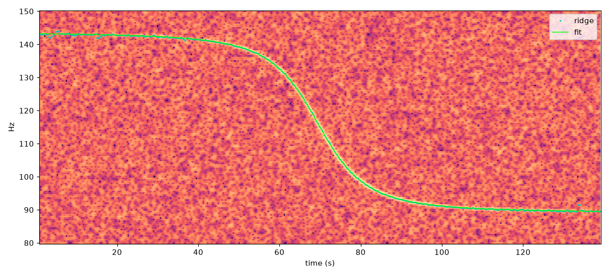

**`score_candidates.py --plot`:** misfit per candidate on a 200 m grid, the curving ADS-B track, the top 5 ranks, and the true observer (star). Rank 1 is the true point; the mirror-image cluster on the other side of the track is ranks 3 to 5.

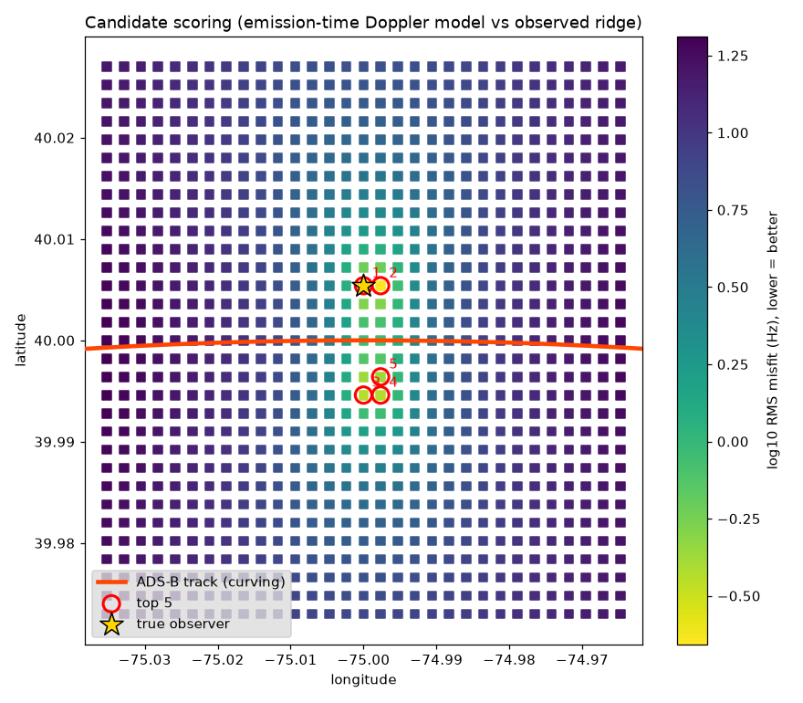

**Terminal:** the self-test, pytest, and `hermes plugins validate .` output captured from the box and rendered to PNG.

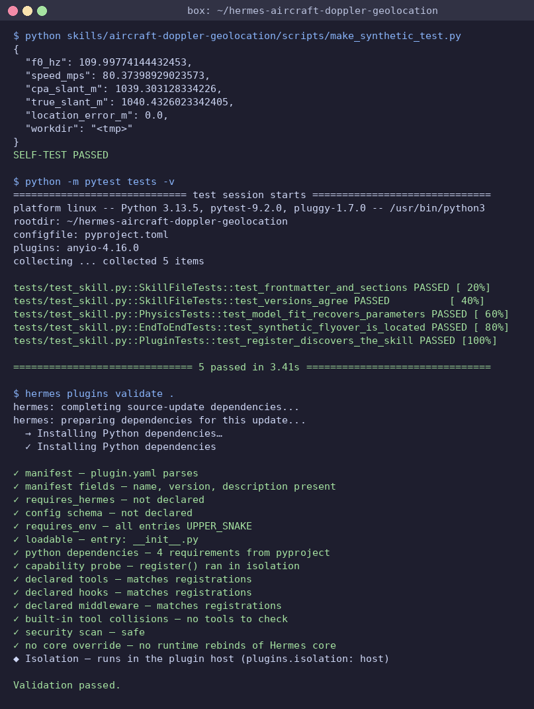

A synthetic propeller tone (110 Hz, 80 m/s, 900 m altitude, gently turning) with tone amplitude 0.29 against noise σ 1.0 is recovered as f0 110.0 Hz, 80.4 m/s, slant 1039 m (true 1040 m). With the recording start known to ±2 s, the true grid point ranks first (0 m error on a 200 m grid). Without a known time, a single flyover lands at the right distance but about 1.4 km off along the track, which is the ambiguity the video describes. A second flyover at a fixed offset, or a known time, is required.

## Evaluation harness

`scripts/eval_batch.py` runs detect + locate on every clip in a manifest and scores the result against ground truth. It reads ADS-B only from the cache, so fetch the days first (for example with one online `dopplergeo locate` run per day and region, or the eval's own fetch scripts).

```bash
export DOPPLER_GEO_CACHE=/path/to/cache
python3 scripts/eval_batch.py manifest.json --out runs/tune --split tune --tol 30 --jobs 2 \
    --det broadband=true --set temper_extra=4
```

Flags: `--tol` (one or more start-time tolerances, s; default 30 600), `--split`, `--only ID ...`, `--set key=value` (`score.Options`), `--det key=value` (`detect_events`), `--radius-km` (15), `--offset-km` (5: the search centre is moved off the truth at a bearing derived from the id), `--jobs` (0 = default: as many workers as fit in 80 % of MemAvailable at `--mem-per-job-gb`, default 2 GB; measured peak 1.7 GB on a 1,600-aircraft crop), `--det-jobs`, `--heatmaps`, `--resume`. Workers are spawned with `OMP/OPENBLAS/MKL_NUM_THREADS = cpu // jobs` unless those are set, so parallel jobs do not oversubscribe BLAS threads.

Events come from the shared event cache (above). Every row carries a `run_key` (hash of the dopplergeo + harness source, the audio bytes, the manifest entry's truth and start time, tolerance, `--set`, `--det`, radius and offset); `--resume` keeps a row only if its `run_key` matches the current run and recomputes the rest.

Manifest: a JSON list. Each entry needs `id`, `audio` (path), `t0_unix` (UTC start of the audio), `truth_lat`, `truth_lon`, `truth_unc_m` (how well the recording spot is known) and `split`. Optional: `skip` (truthy: the harness ignores the clip) and `tol_s_fixed` (a per-clip tolerance that overrides `--tol`, e.g. 9000 s for dab_part1). The other fields (`excluded` with a reason, `loc_evidence`, `time_evidence`, `license`, `attribution`, `url`) are provenance only: the harness does not read `excluded`, so excluded clips are left out with `--split`/`--only`. A real tune entry, trimmed:

```json
{"id": "man_hg0909", "audio": "audio/fs869798.wav", "t0_unix": 1788993240,
  "truth_lat": 53.440355, "truth_lon": -2.099878, "truth_unc_m": 300, "split": "tune6",
  "license": "CC0", "attribution": "Sadiquecat (freesound.org/s/869798)"}
```

Outputs: `rows.jsonl`, one row per clip and tolerance (`err_km`, `confidence`, `events`, `n_consistent`, `a68_km2`/`a95_km2`, `in95` and `in95u` = truth inside the 95 % area, unpadded / padded by `truth_unc_m`, and a `calib` sweep over `temper_extra`, plus `run_key`). Datasets, split policy and how ground truth was established: [docs/evaluation.md](docs/evaluation.md).

## Real-world results

### Tonal pipeline (0.2.0)

The full pipeline (events → historical ADS-B → grid search) was evaluated on public recordings with a known location and start time: the original 12 clips plus 25 livestream VODs filmed at known spotting locations. Clips were split by location before any tuning, giving 23 tune clips and 14 held-out clips. Runs use a ±30 s start-time tolerance (the original tune clips also keep a ±600 s run for crq; dab_part1 runs at ±9000 s). Each run searched a 15 km radius around a centre offset 5 km from the truth. Settings were tuned on the tune split only. The held-out split was then run once with the frozen defaults (`sigma_model=0.008`, `detect_prob=0.15`, sub-harmonic relabel, CPA-distance consistency term, `temper_extra=4`).

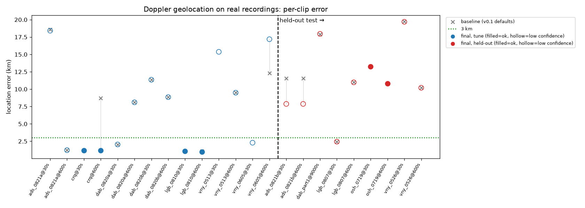

| | runs | no events / no ADS-B | solved | error < 3 km | median error (solved) | truth inside 95% area* |
|---|---|---|---|---|---|---|
| Tune | 24 | 11 / 1 | 12 | 5 | 7.2 km | 9 / 12 |
| Held-out, previous (5 clips, ±30 s and ±600 s) | 9 | 0 | 9 | 1 | 10.8 km | 3 / 9 |
| **Held-out, final (14 clips, ±30 s)** | 14 | 6 / 0 | 8 | **1** | **12.1 km** | 6 / 8 |

*"95% area" is the 95% credible area padded by the truth location's own uncertainty, using the shipped calibration. Point estimates on the 5 original held-out clips at ±30 s are unchanged from the previous run; the median moved because the new held-out clips are harder, not because the method got worse.

**Livestream clips mostly fail.** 12 of the 16 new tune clips and 6 of the 9 new held-out clips produced no usable events. Spectrograms show why: the stream audio is dominated by host commentary or gated ATC radio, is high-passed (around 80–120 Hz) and compressed, and jet passes appear as broadband noise without tonal engine lines. ADS-B had plenty of close passes for these clips, so the data side is not the problem. Four of these tune clips were diagnosed individually and marked excluded in the manifest; the rest are counted as failures above. Fixing this needed a broadband model rather than looser detector gates; see the next section.

**Field recordings (chunk 6).** A third set used raw, dated, geotagged field recordings with no commentary: Freesound (CC0/CC-BY) and radio aporee ::: maps (public domain), each with the recordist's own date/time and map pin. Clip times were checked against ADS-B (aircraft passing near the pin line up with audible passes in most clips), and clips with no ADS-B data or no aircraft in the clip were excluded. The 7 usable tune clips (Manchester approach x2, Brussels x2, Burgundy, Gergueil, Ramallah) gave 2 solved runs out of 14 (man_hg0903 10.5 km, Ramallah 19.8 km, both low confidence); the other 12 runs found no events. The 4 test clips available so far (Orlando, Edinburgh, The Hague, Munich north runway) were run once with frozen settings and all 8 runs found no events. Spectrograms show why: even with clean audio and full low end, close jet passes are broadband, with strong ground-reflection (Lloyd's mirror) interference fringes, and their tonal lines are weak or short. Without a broadband/fringe Doppler model, the detector rejects them, and no gate change was made. One robustness fix came out of this: cache files (DEM tiles, weather, type table, ADS-B crops) are now written atomically, so parallel jobs no longer read half-written files.

**Calibration (`temper_extra=4`).** Without extra tempering, the 95% areas were badly overconfident (the unpadded area contained the truth in 0 of 23 earlier runs). The search now multiplies the Birge temperature by `temper_extra` (default 4, chosen on the tune split). On tune this covers 9 of 12 solved runs; at 64 it covers 11 of 12 but the area grows to the whole 15 km search disc, which is useless. With only 12 tune rows, this calibration is rough.

**Confidence flag.** A result is flagged `confidence: low` when fewer than 2 matched events fit well and agree with the CPA distance. Low-confidence results report the whole search area as their 95% region, so the 95% region is only meaningful when confidence is `ok`.

| | right (< 3 km) | wrong |
|---|---|---|
| tune: ok | 3 | 0 |
| tune: low | 2 | 7 |
| held-out: ok | 0 | 1 |
| held-out: low | 1 | 6 |

**What works:** clips with several clean propeller passes near an airfield (crq, lgb_0810) locate to about 1 km and are flagged ok.

**Limitations:** on unseen clips the method mostly fails (1 of 14 held-out runs under 3 km, 6 with no events at all). An `ok` flag is not a guarantee: osh_0719 was the only held-out `ok` result, it was 13.2 km off, and its 95% area missed the truth. One flyover leaves the along-track position ambiguous, and the likelihood then prefers the wrong aircraft. With these small samples the numbers are indicative, not precise. Treat any output as a hypothesis to check, not as a location.

### Broadband events (0.3.0, `--broadband`)

Results at ±30 s on tune, with the code frozen at ff25280:
- man_hg0903 (a 75-minute recording under the Manchester approach) went from 10.5 km to **0.19 km**, flagged ok.
- man_hg0909 went from no events to **0.33 km**, flagged ok.
- On the old tune clips: vny_0513 went from 15.4 to 2.95 km, ord from 15.2 to 5.9 km and jfk from 10.8 to 4.6 km. crq went from 1.16 to 1.55 km. The other old clips were unchanged.
- Most field and livestream clips still give no broadband events: a clear fringe pattern is needed.

**Held-out (one frozen run at ff25280, `--det broadband=true`, ±30 s; dab_part1 ±9000 s).** 18 clips: 5 original test, 9 livestream test2, 4 field-recording test6. "Before" is the tonal-only 0.2.0 run (c5_heldout / c6_test); muc_ap82011 had no tonal-only run because its ADS-B day arrived later.

| clip | split | before | after (broadband on) | truth in padded 95 % |
|---|---|---|---|---|
| dfw_iNsj | test2 | no events | **1.96 km**, low | yes |
| lgb_0807 | test | 2.44 km, low | **2.38 km, ok** | yes |
| dub_or3L | test2 | no events | 4.74 km, ok | yes |
| lgw_1pyp | test2 | 5.14 km, low | 5.14 km, low | yes |
| muc_ap82011 | test6 | — | 13.07 km, ok | **no** |
| osh_0719 | test | 13.24 km, ok | 13.24 km, ok | **no** |
| ads_0821b | test | 7.88 km, low | 17.24 km, low (regression) | yes |
| dab_part1 | test | 17.87 km | 17.96 km, low | yes |
| syd_DuZb | test2 | 11.01 km, low | 18.58 km, low (regression) | **no** |
| atl_0IA3 | test2 | 18.61 km, low | 18.61 km, low | yes |
| vny_0526 | test | 19.69 km, low | 19.69 km, low | yes |
| sxm_4e38, dus_3afV, phx_L2dM, phx_rnu4 | test2 | no events | no events | — |
| muc_ap81998, edi_ap82914, hag_ap83009 | test6 | no events | no events | — |

| | runs | solved | error < 3 km | median error (solved) | truth in padded 95 % |
|---|---|---|---|---|---|
| Tonal only (0.2.0), 14 clips | 14 | 8 | 1 | 12.1 km | 6 / 8 |
| **Broadband on (0.3.0), 18 clips** | 18 | 11 | **2** | **13.2 km** | 8 / 11 |

Honest reading: broadband events add solved runs (dfw and dub went from no events to an answer) and one more run under 3 km, but the median of solved runs got slightly worse, and two clips regressed (ads_0821b 7.9 → 17.2 km, syd 11.0 → 18.6 km). Of the four `ok` results, lgb (2.4 km) and dub (4.7 km) are roughly right, while osh (13.2 km) and muc_ap82011 (13.1 km) are wrong, and their 95 % areas miss the truth. The field recordings at Edinburgh, The Hague and Munich north, and most livestreams, still give no events. On unseen clips the method still mostly fails.

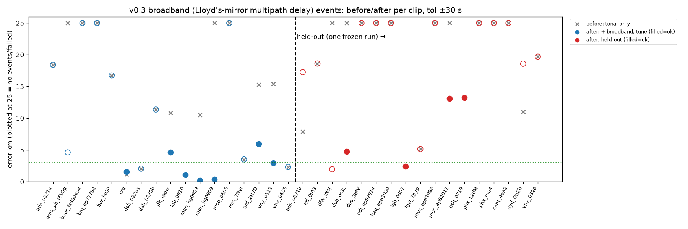

### Manual scripts on YouTube audio (v0.1.1)

**Automatic detection on the same clips (0.2.0, no hand-picked bands):** Cessna 421 clip: 1 event (49 m/s, 159 m CPA). "Planes overhead / birds" clip: 2 events (57 m/s at 1.4 km; 67 m/s at 1.1 km). Amsterdam city ambience, a 23 s jet clip, and the Conquest tower flyby: 0 events (expected: no clean tonal pass).


Run on 5 public YouTube clips (audio only), 2026-11-02:

| Clip | Result |
| --- | --- |
| [Planes Flying Overhead While the Birds Sing](https://www.youtube.com/watch?v=G0fjcT-SP1o) (City Limits Sound) | 2 flyovers detected: 94.9 Hz, 59 m/s, 1.53 km, 1.27 Hz rms; and 247.6 Hz (2nd harmonic), 97 m/s, 2.08 km, 0.61 Hz rms. The two harmonics of pass 2 disagree on speed by about 8%, so treat the stderr as optimistic. |
| [Cessna 421 takeoff, Puerto Princesa](https://www.youtube.com/watch?v=DqZ2411R1ys) (Palawan Skies Aviation) | Detected in 85-145 Hz: 109.4 Hz, 63 m/s (~122 kt), 295 m. A higher band failed: the tracker hops between crossing harmonics. |
| [Cessna Conquest 425 flyby, Hannover](https://www.youtube.com/watch?v=yltKJzPAcb4) (HD1080ide) | Rejected. The plane was turning, so the straight-pass model does not apply. |
| [Evening City Ambience in Amsterdam](https://www.youtube.com/watch?v=VZDnXSN6Cgg) (Jeronimo Ambience) | No detections. |
| [Outdoor atmosphere with plane flying over](https://www.youtube.com/watch?v=aeC-UfLcxqk) (Your Film Sounds) | Broadband roar with no tone. 0.1.0 reported a false fit here; 0.1.1 rejects it (`ridge_snr_z` 1.7). |

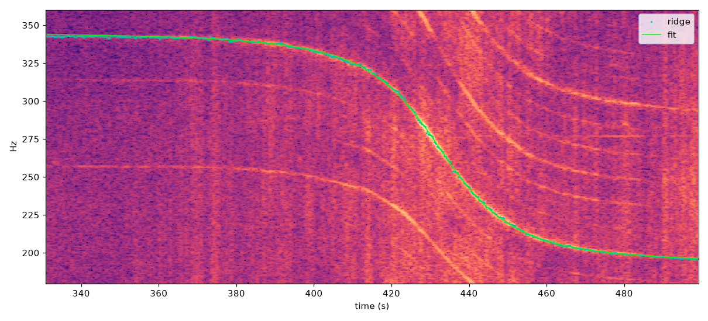

*Spectrogram of audio from City Limits Sound's video [Planes Flying Overhead While the Birds Sing in the Distance](https://www.youtube.com/watch?v=G0fjcT-SP1o), with the traced ridge and fit.*

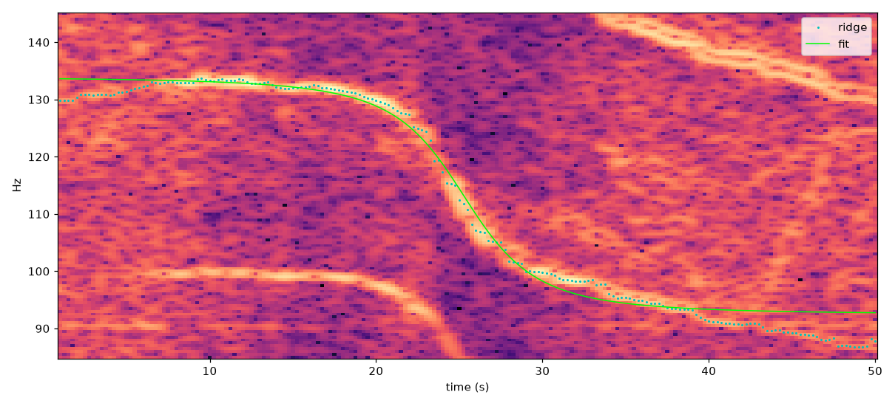

*Spectrogram of audio from Palawan Skies Aviation's video [Cessna 421 Golden Eagle takeoff at Puerto Princesa](https://www.youtube.com/watch?v=DqZ2411R1ys).*

The tracker works on clean real tones. You still pick the frequency band and time window by eye from a spectrogram, and the `detected` flag is the guard against noise. Real tones scored 2.7 to 3.6 on `ridge_snr_z` and noise scored 1.7 to 2.0, so the margin is narrow. Geolocation scoring could not be tested: none of the clips gives a recording date or time, and no free historical ADS-B was used.

## Limitations

- Tonal detection needs propeller or engine lines. Broadband detection needs a clear ground-reflection fringe pattern (hard, flat ground; a close pass; the CPA inside the recording). Commentary-heavy, gated or high-passed livestream audio gives no events either way.
- Generalisation is unproven: 1 of 14 tonal held-out runs was under 3 km (median 12.1 km for solved runs), and with broadband on, 2 of 18 (median 13.2 km). `confidence: ok` is not a guarantee. With `low`, use the whole search area as the answer.
- One flyover leaves an along-track ambiguity, and a straight track a left/right mirror ambiguity. Turning flights fail the straight-pass broadband fit. Harmonics that cross confuse the manual `doppler_track.py`.
- Needs a date, adsb.lol coverage for that day (some 2023–2024 releases have no data), a region of at most 60 km radius, and about 3 GB of download per uncached day.

## Privacy and ethics

Use for forensics, journalism, research, or auditing your own recordings. Locating a person without consent can put them in danger; follow local law. Results are probabilistic and need independent visual confirmation. To protect your own clips: high-pass filters and talking over the tone do not reliably remove it, and it can survive phone compression; cutting segments, stronger noise suppression, and stripping timestamps help. Check your own spectrogram with `doppler_track.py` before publishing.

## Tests

```bash
pip install -e ".[dev]"           # pytest, ruff (pinned), pyyaml; needs ffmpeg on PATH
python3 -m pytest tests -q        # network tests run only with DOPPLER_GEO_NETWORK_TESTS=1
ruff check . && ruff format --check .
```

### Development / checks

CI (`.github/workflows/checks.yml`) runs on every pull request and on pushes to `main`, on Python 3.11 with FFmpeg from apt. The same checks locally:

```bash
sudo apt-get install ffmpeg       # or your platform's package
python3 -m pip install -e ".[dev]"
ruff check .
ruff format --check .
python3 -m pytest tests -q        # offline; leave DOPPLER_GEO_NETWORK_TESTS unset
```

`tests/test_cli_flags.py` covers the `--broadband` / `--temper-extra` flags and tool parameters, and the offline error message. `tests/test_broadband.py` covers the synthetic broadband pass (geometry recovered for 1.5 m and 5 m mic heights), noise-only and steady-tone negatives, the scorer picking the true point, and tonal events ignoring jets.

Screenshot from an early 0.2.0 run (21 tests). The suite now has 64 tests: 62 pass, 2 network tests skip. Equivalence tests pin the optimised scorer and Viterbi to frozen 0.3.0 copies (`tests/ref_score_v030.py`, `tests/test_viterbi_vectorised.py`); `tests/test_event_cache.py` and `tests/test_eval_identity.py` cover cache hits, misses, corruption and invalidation, and eval resume identity.

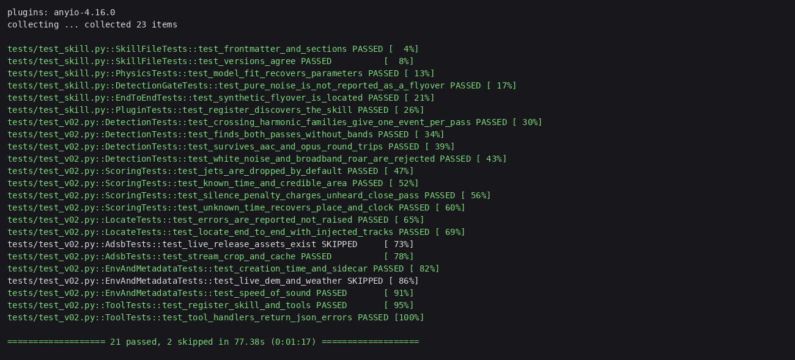

## License

MIT for the code. Data you download stays under its own licence (above): ADS-B crops in the cache are ODbL.
